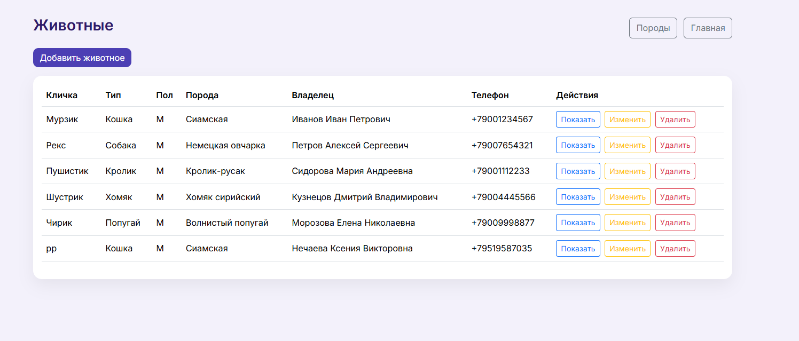
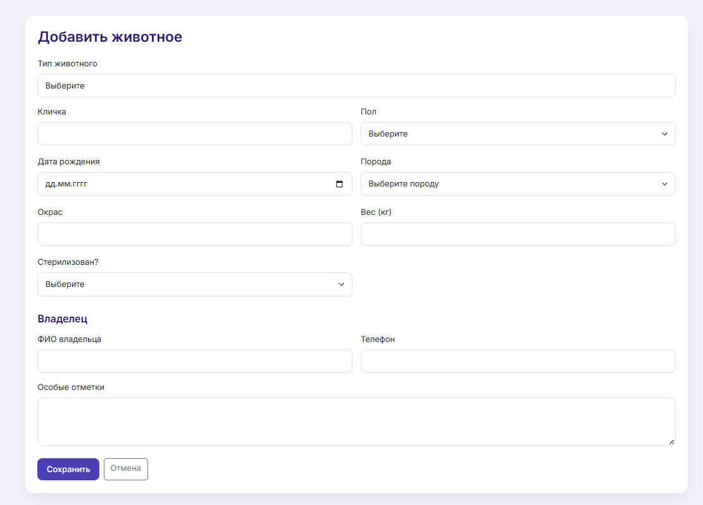
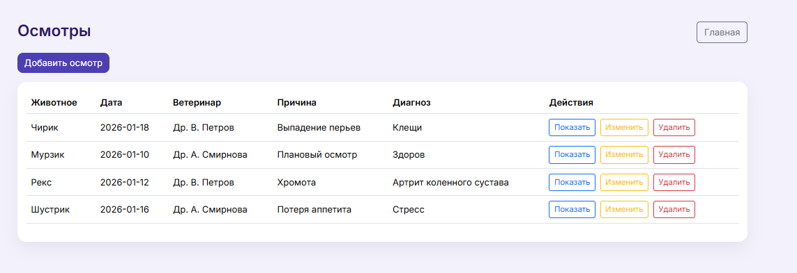
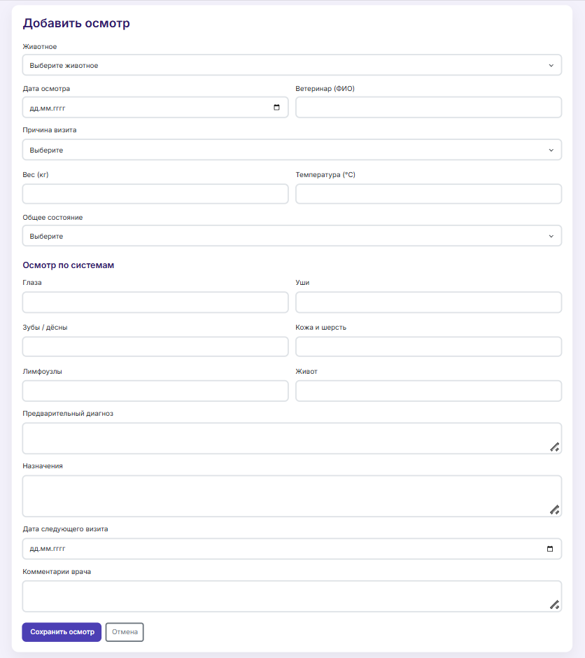
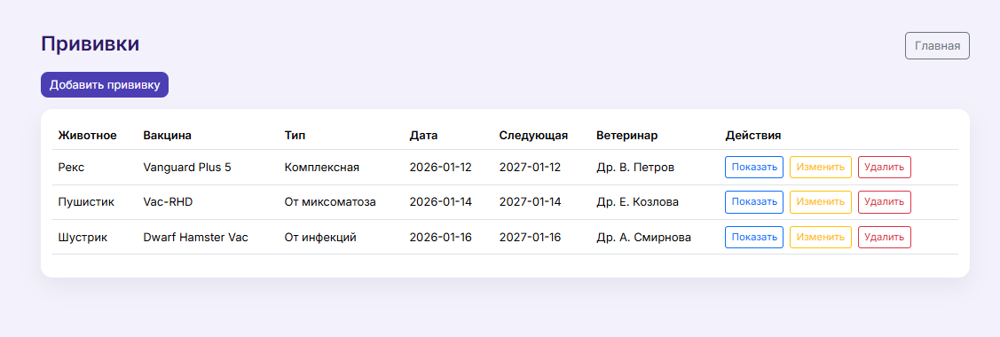
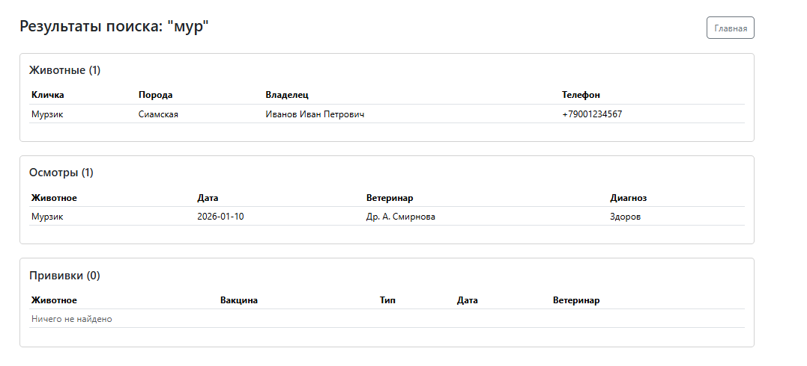
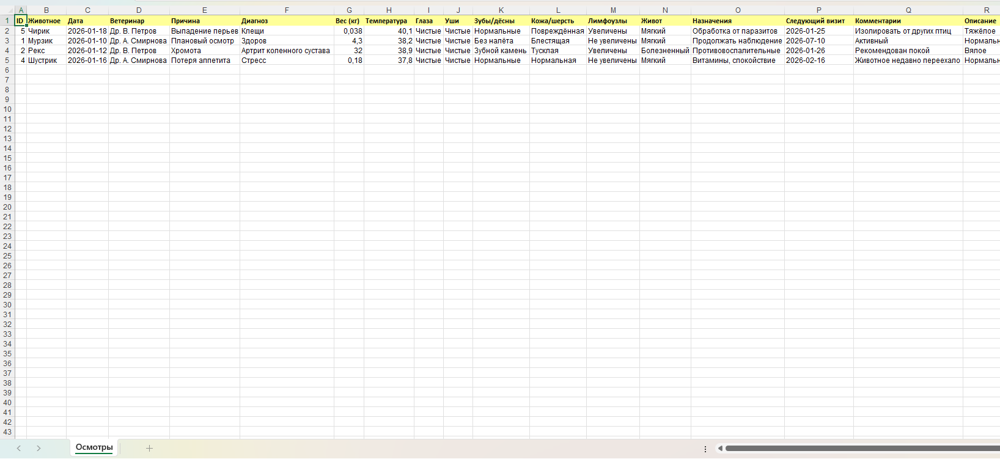
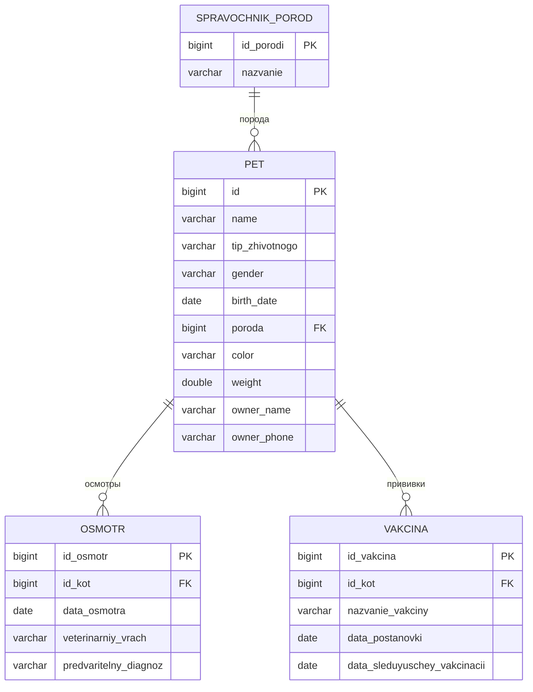

# 🐾 Ветеринарная клиника — учёт пациентов

Веб-приложение для ветеринарной клиники: картотека животных, журнал осмотров и прививок, справочник пород. Можно искать по всем данным сразу и выгружать отчёт по осмотрам в Excel.


## Возможности

- **Животные:** кличка, вид, пол, порода, окрас, вес, стерилизация, номер чипа, особые отметки, данные владельца.
- **Осмотры:** врач, причина визита, вес и температура, состояние глаз, ушей, зубов, кожи, лимфоузлов и живота, предварительный диагноз, назначения, дата следующего визита.
- **Прививки:** вакцина и её тип, даты постановки и следующей вакцинации, серия, реакция, врач.
- **Справочник пород.**
- Просмотр, добавление, редактирование и удаление для каждой таблицы.
- Проверка ввода на сервере (Bean Validation) и в браузере (HTML5). Ошибки выводятся прямо на форме.
- Поиск сразу по животным, осмотрам и прививкам.
- Выгрузка осмотров за выбранный период в Excel (`.xlsx`, Apache POI).

## Скриншоты

**Список животных**



**Добавление животного**



**Журнал осмотров**



<details>
<summary>Форма осмотра</summary>



</details>

**Прививки**



**Поиск по всем данным**



**Отчёт по осмотрам в Excel**



## Технологии

| Слой | Что используется |
|---|---|
| Язык | Java 21 |
| Фреймворк | Spring Boot 3.5 (Spring Web MVC) |
| Доступ к данным | Spring Data JPA / Hibernate |
| База данных | PostgreSQL |
| Шаблоны | Thymeleaf, Bootstrap 5 |
| Валидация | Jakarta Bean Validation |
| Отчёты | Apache POI |
| Сборка | Maven |

## Структура базы данных



## Архитектура

Приложение разбито на слои:

```
src/main/java/ru/cat/cattery/
├── entity/       # JPA-сущности: Pet, Osmotr, Vakcina, SpravochnikPorod
├── repository/   # интерфейсы Spring Data JPA
├── service/      # бизнес-логика
└── controller/   # MVC-контроллеры: CRUD, поиск, отчёт в Excel
src/main/resources/templates/   # страницы Thymeleaf
```

## Запуск

1. Установите JDK 21 и PostgreSQL.
2. Создайте пустую базу данных:
   ```sql
   CREATE DATABASE cattery;
   ```
3. Укажите логин и пароль к базе в `src/main/resources/application.properties`.
4. Запустите приложение:
   ```bash
   ./mvnw spring-boot:run
   ```
5. Откройте http://localhost:8080.

Таблицы создаются автоматически при первом запуске (`spring.jpa.hibernate.ddl-auto=update`).
